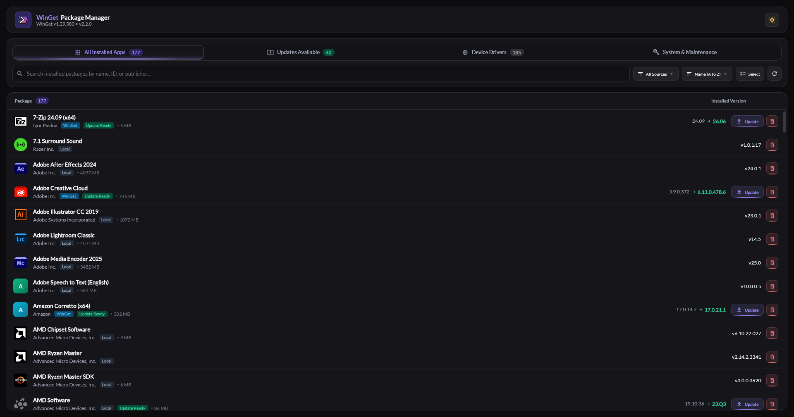
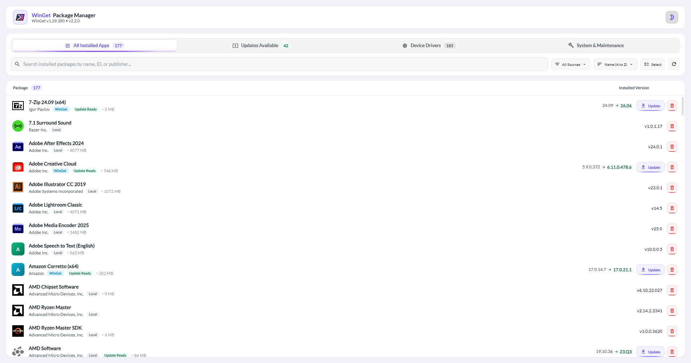
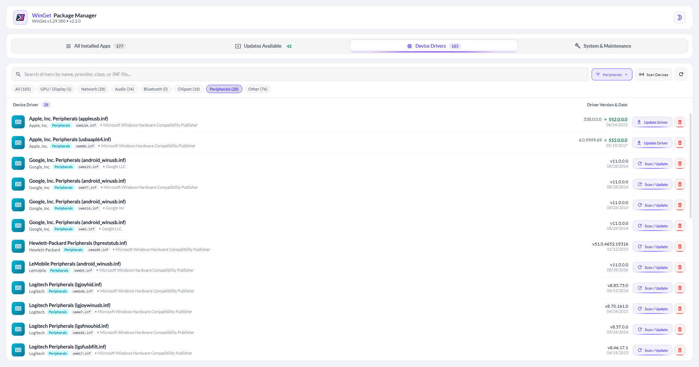
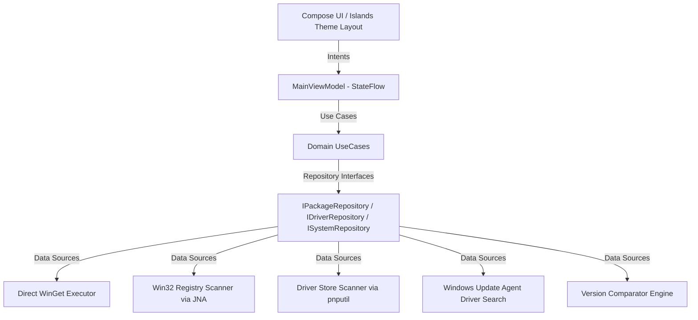

# KMP WinGet Package Manager (Windows)

A modern, high-performance Windows package manager built with **Kotlin Multiplatform (Compose Desktop)** and **Material Design 3 with an Islands Architecture**. It combines a direct WinGet CLI engine with native Win32/JNA integrations for a fast, clean package, driver, and system-maintenance workflow on Windows 10/11.

[](https://github.com/StarkDroid/kmp-winget/releases/latest)

[](LICENSE)

## 🖼️ Screenshots

| Dark Mode | Light Mode |
| :---: | :---: |
|  |  |

**Device Drivers & Windows Update resolution**



## ✨ Modern Features & Highlights

- 🏝️ **"Islands" Theme Layout**: Structured into clean, elevated Island containers (Header Island, Nav & Controls Island, Main Table Island, System Tools Island) rather than repetitive individual card boxes.
- ✨ **Luminous Tab Underglow**: Selected navigation tabs feature a soft, aesthetic neon underglow beam with dynamic status indicators.
- ⚡ **High-Performance Direct Process Engine**: Direct non-blocking WinGet CLI execution with streamable output logs and a JNA Win32 Registry scanner for instantaneous initial load times (<30ms).
- 🔄 **Local & Non-WinGet App Updates**: Intelligent semantic version comparator and WinGet catalog resolver that automatically detects and triggers updates for apps installed via EXE, MSI, or Add/Remove Programs.
- 🧩 **Driver Store Management**: Enumerates installed driver packages with `pnputil`, groups them by device class, and removes obsolete driver packages on demand.
- 🪟 **Windows Update Driver Discovery**: Driver updates are resolved from the **Windows Update Agent (WUA)** driver catalog and installed through Windows Update. WinGet is intentionally never used as a driver update source.
- 🗑️ **Safe & Batch Operations**: Multi-select mode with safety confirmation modals to upgrade or uninstall multiple applications in batch.
- 🔍 **Real-Time Search & Smart Filtering**: Instant debounced search by name, ID, publisher, with filters by source (`winget`, `msstore`, `local`) and multi-criteria sorting.
- 🧹 **System & Maintenance Dashboard**: Live CPU/RAM/network telemetry, real driver-store VRAM detection, storage drive breakdown (C:, D:, etc.), one-click Windows Disk Cleanup launcher, and WinGet source/cache optimization.
- 🌗 **Adaptive Material 3 Dark/Light Theming**: Clean single-switch theme toggle with smooth animation and native Windows title bar synchronization.
- 📜 **Live Operation Terminal**: Real-time live log drawer in operation dialogs to view stdout/stderr streaming from package management operations.
- 🚀 **Automated Releases**: Every merge to `main` builds `.msi` and `.exe` installers, generates a changelog from commit history, and publishes a GitHub release with SHA-256 checksums.

---

## 🏗️ Architecture & Best Practices

The app follows **Clean Architecture & MVI (Model-View-Intent)** principles with unidirectional data flow:



- **Domain Layer**: Clean business entities (`Package`, `DriverPackage`, `PackageFilter`, `SystemStats`, `OperationResult`), domain services (`VersionComparator`, `PackageDeduplicator`), and use cases (`GetPackagesUseCase`, `UpgradePackageUseCase`, `UninstallPackageUseCase`, `BatchOperationUseCase`, `SystemToolsUseCase`, `GetDriversUseCase`, `UpdateDriverUseCase`).
- **Data Layer**: Direct process executor (`WinGetExecutor`), positional column parser (`WinGetParser`), JNA Win32 Registry scanner (`WindowsRegistryScanner`), Driver Store scanner (`WindowsDriverStoreScanner`), Windows Update Agent driver scanner (`WindowsUpdateDriverScanner`), and repositories with cache-first emissions.
- **Platform Layer**: Native Windows integrations (`WindowsNativeBridge` for DWM theming, `WindowsIconLoader`, `WindowsUpdateLauncher`).
- **Presentation Layer**: Compose Multiplatform Desktop with Material 3 Islands theme, glowing tab underglow, and reactive ViewModel state flows.
- **Dependency Injection**: Koin 4.2.2 (`koin-compose-viewmodel`).

### Driver Update Source

WinGet is an application package manager and does not publish a driver catalog. Therefore:

- Installed drivers are enumerated from the Windows Driver Store with `pnputil /enum-drivers`.
- Available driver updates are searched through the **Windows Update Agent** (`Microsoft.Update.Session`, `Type='Driver'`).
- Installing a driver update opens Windows Update, where Windows performs the OEM compatibility check and installation. The app never silently installs driver packages.

---

## 🚀 Getting Started

### Prerequisites
- Windows 10 (version 1809+) or Windows 11.
- [WinGet (Windows Package Manager CLI)](https://learn.microsoft.com/en-us/windows/package-manager/winget/) (pre-installed on modern Windows 10/11).
- JDK 17+.

### Run Locally

```bash
# Clone the repository
git clone https://github.com/StarkDroid/kmp-winget
cd kmp-winget

# Run the desktop application
./gradlew run
```

### Build Distribution (.exe / .msi)

```bash
./gradlew packageDistributionForCurrentOS
```

---

## 🛠️ Tech Stack

- **Framework**: Kotlin Multiplatform (Compose Multiplatform 1.12.2 / Compose Desktop)
- **Language**: Kotlin 2.4.21
- **Build**: Gradle 9.3.1 (wrapper)
- **Native Windows Interop**: JNA 5.19.1 (`jna`, `jna-platform`; Win32 `dwmapi`, `Advapi32`, `IPHlpAPI`)
- **Dependency Injection**: Koin 4.2.2 (`koin-compose-viewmodel`)
- **State & Async**: Kotlin Coroutines 1.11.0 & StateFlow
- **Design System**: Material Design 3 with Islands Layout & Luminous Tab Underglow

---

## 📄 License

Distributed under the **GNU Affero General Public License v3.0 (AGPL-3.0)**. See [`LICENSE`](LICENSE) for the full text.
